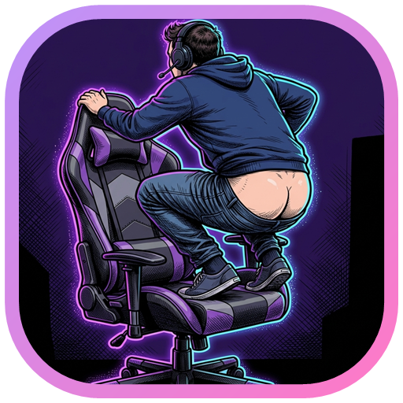

# ⚡ Babilonia Buff — LoL Live Companion & AI Coach

<p align="center">
  
</p>

Assistente em tempo real para **League of Legends** inspirado no **Blitz.gg**, com tema **modo escuro**, executável nativo para Windows (**`Babilônia Buff.exe`**) com ícone na Barra de Tarefas e na Bandeja do Sistema (System Tray), e conexão 100% automática ao cliente do jogo (sem precisar de chave da Riot API e 100% seguro contra banimentos do Vanguard).

## 🚀 Funcionalidades Principais

- **🖥️ Executável Nativo (`Babilônia Buff.exe`):**
  - Abre uma central desktop em **modo escuro** com o ícone oficial do **Babilonia Buff** visível tanto na **Barra de Tarefas do Windows** quanto na **Bandeja do Sistema (System Tray, perto do relógio)**.
  - Inicia o servidor Node.js automaticamente em segundo plano (sem janela preta de CMD) e abre o painel do aplicativo em modo janela dedicada (`--app`).
- **🏠 Home & Perfil Real do LoL:** Conecta sozinho ao cliente aberto e exibe seu `Nome#TAG`, Nível, Elo Ranqueado Solo/Duo, PDL e Vitórias/Derrotas.
- **📍 Detecção Automática de Lane + 6 Sugestões Pós-Ban (3 + 3 Sem Repetição):**
  - Reconhece em qual rota você caiu na Seleção de Campeões (`Top`, `Jungle`, `Mid`, `ADC`, `Suporte`).
  - Filtra automaticamente os campeões banidos e exibe **3 Counters diretos contra seu oponente de rota** + **3 Campeões mais fortes do Meta atual** (pulando automaticamente caso algum campeão se repita entre as listas!).
- **⚔️ 3 Opções de Build por Campeão:**
  1. **🏆 Build Maior Winrate:** A build mais vitoriosa do patch atual.
  2. **⚡ Build Alternativa:** Variação tática de estilo de jogo.
  3. **🛡️ Build Anti-Time Inimigo:** Analisa os 5 campeões adversários (% AD vs AP, Tanques, Cura e Controle de Grupo) e adapta suas Botas, Corta-Cura, Penetração e Defesa automaticamente.
- **⚡ Auto-Import de Runas (1-Clique):** Exporta a página de runas da build escolhida direto para dentro do seu League of Legends.
- **🧠 IA que observa a partida (sem chat, sem voz):** Lê a partida a cada 2s pela porta 2999 (ouro, KDA, CS, vida, itens, objetivos, mortes e eventos) e mostra popups curtos com o que fazer agora: recall com o item certo, dragão/Barão chegando, oponente de rota morto, vantagem ou desvantagem numérica, inimigo forte e como adaptar a build. A frequência é limitada para não poluir a tela. Na tela Partida Ao Vivo, o **Assistente Tático IA** mostra as dicas passando e tem perguntas prontas (o que comprar, recuar ou lutar, maior ameaça, próximo objetivo, farm e build), sem chat livre.
- **🗂️ Telas por fase:** Draft e Partida Ao Vivo ficam desligados (OFF) fora de jogo e ligam sozinhos na Seleção de Campeões e na partida.
- **🏠 Início estilo perfil do Blitz (sem anúncios):** elo Solo/Duo e Flex, histórico de PDL (guardado pelo app a cada abertura), últimas partidas lidas do cliente, desempenho por campeão nas ranqueadas e quem jogou com você.
- **🧙 Campeões e 🏆 Tier List só de ranqueada Solo/Duo:** filtros por rota e estilo, faixas S/A/B/C. Campeões sem dado de ranqueada no app aparecem sem porcentagem.
- **🧩 Overlays:** liga/desliga salvo para notificações de objetivos, benchmarking de CS, tela de carregamento, timers de inibidor, ordem de habilidades, lembrete de sentinela e diferença de valor de itens. Timers de selva, de ultimate e desenho por cima do jogo estão marcados como "em breve".

---

## 💻 Como rodar na sua máquina

1. Certifique-se de ter o [Node.js](https://nodejs.org/) instalado.
2. Clone este repositório:
   ```bash
   git clone https://github.com/PhilippeSouza/babilonia.git
   cd babilonia
   ```
3. **Para abrir com o Executável e Ícone na Barra do Windows:**
   - Dê dois cliques diretamente em **`Babilônia Buff.exe`** (ou em **`Iniciar-Babilonia.bat`**).
   - O launcher abre o app e fecha sozinho. O servidor continua em segundo plano e encerra sozinho 5 minutos depois que você fecha a janela do app.
4. Para recompilar o executável depois de mudar `src/BabiloniaLauncher.cs`, dê dois cliques em **`Recompilar-Launcher.bat`**, ou rode:
   ```powershell
   & "C:\Windows\Microsoft.NET\Framework64\v4.0.30319\csc.exe" /nologo /codepage:65001 /target:winexe /win32icon:"Babilônia Buff-icone.ico" /out:"Babilônia Buff.exe" /r:System.dll /r:System.Drawing.dll /r:System.Windows.Forms.dll src\BabiloniaLauncher.cs src\BabiloniaOverlay.cs
   ```

---

## 🔄 Como continuar o desenvolvimento no Antigravity em outro PC

Ao abrir esta pasta no **Antigravity** no seu computador pessoal, basta enviar na primeira mensagem do chat o texto indicado no arquivo `CONTEXTO_PROJETO.md`.
